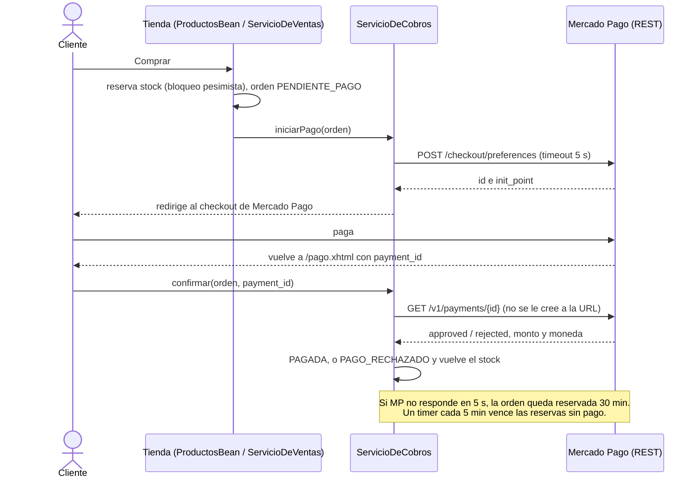
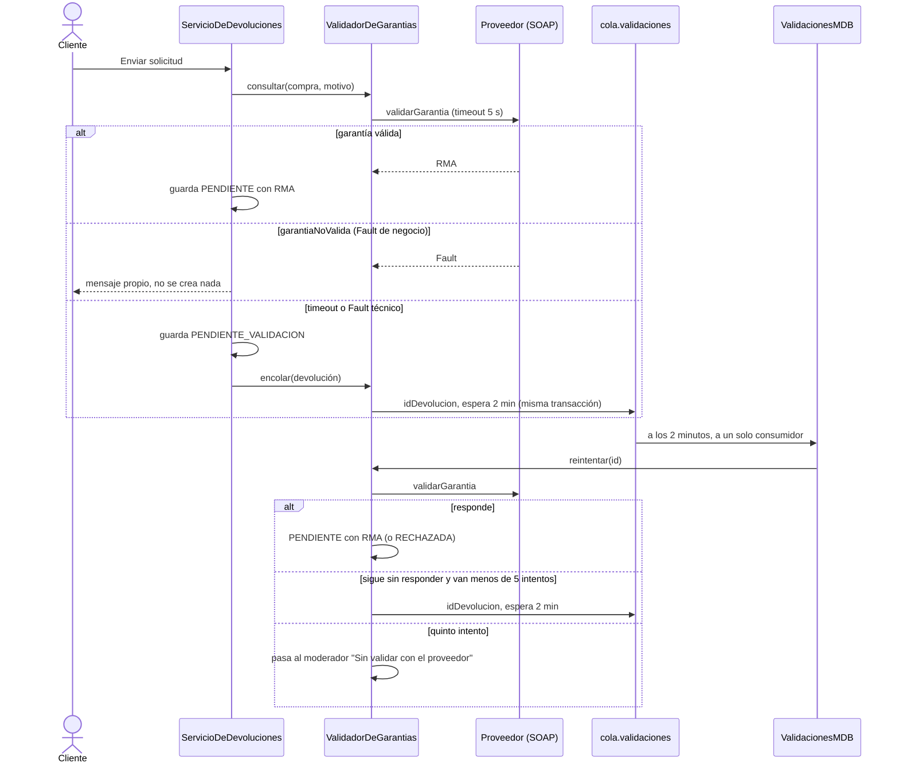
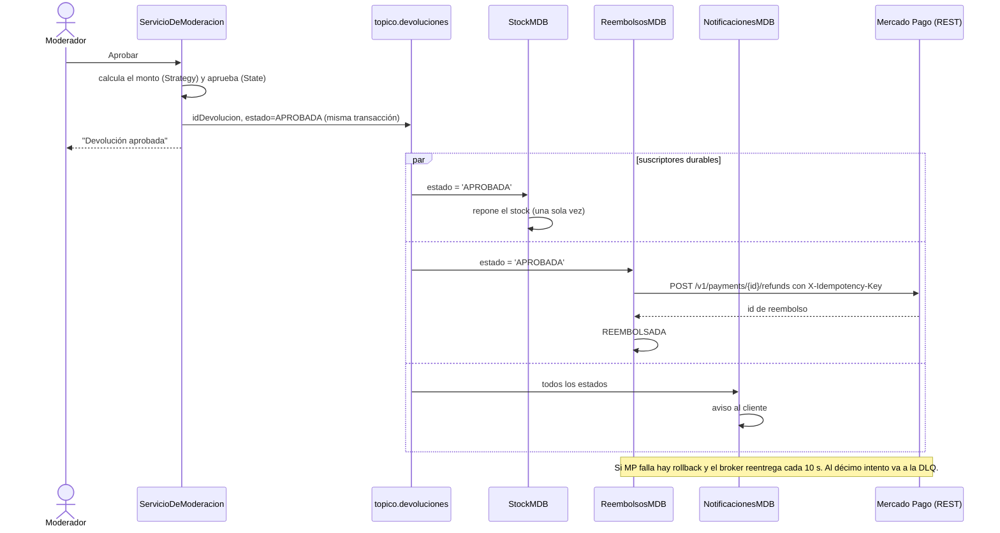

# Aura Cycles — Reseñas y Devoluciones de Repuestos de Bicicleta

TP Integrador · Desarrollo de Aplicaciones II · UADE · Grupo 3

Tienda de repuestos de bicicleta con foco en la posventa: el cliente compra y paga con Mercado Pago, puede reseñar lo que compró y pedir la devolución. La garantía se valida con el proveedor mayorista por SOAP, un moderador resuelve reseñas y devoluciones, y al aprobar una devolución el reembolso, el stock y el aviso al cliente salen solos por mensajería.

## Levantar todo con un comando

Así se corre para la demo y para las entregas, y es lo mismo que corre el CI. Solo hace falta **Docker** (Docker Desktop en Windows o Mac). Desde la carpeta del repo:

```bash
docker compose up --build
```

La primera vez tarda unos minutos (baja las imágenes y compila con Maven adentro del contenedor). Cuando en la consola aparece `WFLYSRV0025: WildFly ... started`, está listo:

| Qué | Dónde |
|---|---|
| La tienda | https://localhost:8443/repuestos (http://localhost:8080 redirige) |
| Mercado Pago simulado (modos para la demo) | http://localhost:8089/__modo |
| Proveedor SOAP simulado (WSDL y modos) | http://localhost:8090/proveedor?wsdl · http://localhost:8090/__modo |
| Consola del broker Artemis (colas y tópicos) | http://localhost:8161 |

El certificado es autofirmado (lo genera WildFly), así que la primera vez el navegador avisa: "Avanzado" > "Continuar a localhost".

Usuarios de prueba, todos con la clave `Clave1234`: `ana@mail.com`, `carlos@mail.com`, `lucia@mail.com`, `javier@mail.com` (clientes) y `mod@mail.com` (moderador).

Qué levanta: WildFly 37 con la app, MySQL 8.4 con `sql/schema.sql`, el broker Artemis aparte (así se puede apagar en la demo) y los dos sistemas externos simulados. Si cambiaste código: `docker compose up --build` de nuevo. Para empezar de cero: `docker compose down -v`.

Arquitectura en capas sobre Jakarta EE 10:

| Capa | Tecnología | Paquete |
|---|---|---|
| Presentación | JSF (Jakarta Faces 4.0) + CDI | `presentacion/` + `webapp/*.xhtml` |
| Negocio | EJB (Jakarta Enterprise Beans) | `negocio/` |
| Integración | Cliente REST de Mercado Pago y cliente SOAP del proveedor | `integracion/` |
| Mensajería | Consumidores del tópico y de la cola (MDB) | `mensajeria/` |
| Datos | JPA / Hibernate + MySQL | `datos/` + `modelo/` |

---

## 1. Abrir el código en Eclipse

1. `File → Import → Maven → Existing Maven Projects`
2. Elegí la carpeta del repo (la que tiene el `pom.xml`).

Para leer o editar el código no hace falta WildFly ni MySQL. Para verlo andando se usa `docker compose up --build`.

| Dónde | Qué hay |
|---|---|
| `negocio/` | Los servicios EJB: `ServicioDeModeracion` (fachada del panel), `ServicioDeDevoluciones` (stateful), `ServicioDeCobros`, `ValidadorDeGarantias` y el resto |
| `negocio/reembolso/` | Las políticas de reembolso (Strategy) |
| `modelo/` | Entidades y estados; `EstadoDevolucion` es el State |
| `integracion/` | `ClienteMercadoPago` (REST) y `ClienteProveedor` (SOAP) |
| `mensajeria/` | `StockMDB`, `ReembolsosMDB` y `NotificacionesMDB` (tópico) y `ValidacionesMDB` (cola) |
| `src/main/resources/wsdl/` | El WSDL del proveedor |
| `src/test/java/.../integracion/Mock*.java` | Los simuladores de Mercado Pago y del proveedor |
| `docs/adr/` | Las decisiones de diseño |

---

## 2. Correr desde Eclipse (opcional)

Sirve para depurar con breakpoints. Para la demo conviene docker: el broker va aparte y se puede apagar, y no hay que configurar nada.

| Herramienta | Versión | Nota |
|---|---|---|
| JDK | 21 | |
| WildFly | 37, variante **EE 10** | Desde WildFly 40 el estándar pasó a EE 11 y eliminó `@ManagedBean` |
| MySQL | 8.x | Más MySQL Workbench para correr el schema |
| Eclipse | IDE **for Enterprise Java and Web Developers** | La edición "Java Developers" no trae herramientas de servidor |
| JBoss Tools | desde el Eclipse Marketplace | Arranca y para WildFly desde el IDE |

1. **Base.** Abrí `sql/schema.sql` en MySQL Workbench y ejecutalo entero: crea el esquema y carga los datos de prueba.
2. **Perfil con mensajería.** WildFly tiene que arrancar con `standalone-full.xml` (el `standalone.xml` común no trae el broker y las MDB no despliegan). En Eclipse: en el runtime de WildFly, *Configuration file* = `standalone-full.xml`. Por consola: `./standalone.sh -c standalone-full.xml`.
3. **Driver de MySQL.** Con WildFly levantado, en `jboss-cli.sh --connect`:
   ```
   module add --name=com.mysql --resources=/ruta/al/mysql-connector-j-9.x.x.jar --dependencies=java.sql
   ```
4. **Configuración.** Copiá `db.local.properties.example` como `db.local.properties` y poné la clave de tu MySQL (ese archivo no se sube, está en `.gitignore`). Después:
   ```bash
   jboss-cli.sh --connect --file=configurar-standalone-full.cli --properties=db.local.properties --resolve-parameter-values
   ```
   Deja el datasource, el realm con bcrypt, la seguridad declarativa, los reintentos del broker y la redirección de la raíz a la app. Si tu WildFly ya estaba configurado de antes, en lugar de ese corré `configurar-entrega4.cli` (sin `--properties`).
5. **Simuladores.** Botón derecho sobre `MockMercadoPago.java` y `MockProveedorSoap.java` (en `src/test/java/.../integracion`) → `Run As → Java Application`. Quedan en `localhost:8089` y `localhost:8090`.
6. **Servidor.** `Servers → New Server → JBoss Community → WildFly`, `Add and Remove` → agregá el proyecto → `Start`.
7. Entrá a **https://localhost:8443/repuestos** (http redirige; el certificado es autofirmado).

Para usar el sandbox real de Mercado Pago en vez del simulado: en los VM arguments del servidor, `-DMP_ACCESS_TOKEN=TEST-...` (sección 6).

---

## 3. Recorrido para la demo

Con `docker compose up`. El orden recorre las cuatro integraciones.

1. Entrá como `ana@mail.com` → **Productos** → abrí un repuesto → **Comprar**. Se crea la orden en *Pendiente de pago*, el stock baja una unidad y vas al checkout de Mercado Pago (el simulado).
2. **Pagar (aprobado)**. Volvés a la tienda con "Pago acreditado" y la orden *Pagada*. Con **Pagar (rechazado)** en otra compra, la orden queda *Pago rechazado* y la unidad vuelve al stock.
3. **Mis compras** → **Solicitar devolución** en la orden pagada → elegí el motivo → **Enviar solicitud**. La tienda le pide la garantía al proveedor por SOAP y la devolución queda *Pendiente de revisión* con el RMA.
4. Cerrá sesión y entrá como `mod@mail.com` → **Panel** → **Devoluciones pendientes** → **Aprobar**. Se publica en el tópico y en la consola de la app aparecen los tres consumidores: el stock vuelve a subir, el reembolso sale por Mercado Pago y se genera el aviso al cliente. La devolución termina *Reembolsada*.

Fallas para mostrar en vivo:

| Qué | Cómo | Qué se ve |
|---|---|---|
| Proveedor caído | http://localhost:8090/__modo?valor=error y pedir una devolución | "Validando la garantía con el proveedor". El pedido queda en `cola.validaciones` (consola de Artemis) y a los 2 minutos se reintenta; con el proveedor en `normal` pasa al moderador con RMA. A los 5 intentos sin respuesta pasa igual, marcado "Sin validar con el proveedor" |
| Mercado Pago caído al comprar | http://localhost:8089/__modo?valor=lento (o `error`) y comprar | "Mercado Pago no responde. Te reservamos ORD-… por 30 minutos": se paga después desde Mis compras |
| Mercado Pago caído al reembolsar | modo `error` y aprobar una devolución | Queda *Aprobada* y el broker reintenta cada 10 s. Con Mercado Pago en `normal` termina *Reembolsada*; al décimo intento el mensaje va a la DLQ |
| Broker apagado | `docker compose stop artemis` y aprobar | "No pudimos procesarla ahora: la mensajería no responde…" y no cambia nada. Se vuelve con `docker compose start artemis` |

Los modos se vuelven a `normal` con `?valor=normal`.

---

## 4. Diagramas de secuencia de las integraciones

### 4.1 Cobro con Mercado Pago (REST, sincrónico)



### 4.2 Garantía con el proveedor (SOAP, sincrónico) y reintento por la cola (punto a punto, asincrónico)



### 4.3 Aprobación de una devolución: tópico (pub/sub, asincrónico) y reembolso (REST)



---

## 5. Cómo se mapea contra el checklist del TP

| Requisito | Dónde está |
|---|---|
| Mínimo 6 componentes de negocio | 10 EJB en `negocio/` |
| 1 stateful + 1 stateless justificados | `ServicioDeDevoluciones` es `@Stateful` (el borrador de la solicitud vive entre los tres pasos); el resto `@Stateless` |
| Arquitectura en capas explícita | `presentacion/` → `negocio/` → `datos/`, con `integracion/` y `mensajeria/` aparte |
| Patrones de diseño | DAO/Repository (`datos/`), Facade (`ServicioDeModeracion`), Strategy (`negocio/reembolso/`), State (`EstadoDevolucion`). Ver `docs/adr` |
| Seguridad declarativa | `@RolesAllowed("MODERADOR")` en los 6 métodos de `ServicioDeModeracion`, `@RolesAllowed` en los cobros y `security-constraint` en `web.xml` |
| Transacciones declarativas | Aprobar guarda el estado y publica en el tópico en la misma transacción: si el broker falla, no se aprueba nada. Pedir una devolución guarda y encola juntos. La compra descuenta stock con bloqueo pesimista |
| Integración SOAP con WSDL | Proveedor mayorista, `validarGarantia` con Fault (`integracion/ClienteProveedor`, ADR-006) |
| Integración REST con sistema externo | Mercado Pago, cobro y reembolso (`integracion/ClienteMercadoPago`, ADR-005) |
| Mensajería pub/sub | `topico.devoluciones` con tres suscriptores durables |
| Mensajería punto a punto | `cola.validaciones` con `ValidacionesMDB` como único consumidor |
| Diagramas de secuencia | Sección 4 |
| Diseño responsive | Tres breakpoints en `app.css` |
| Temas claro y oscuro (punto extra) | `SesionBean.alternarTema()`, en vivo |

---

## 6. Mercado Pago

La compra reserva el stock y queda `PENDIENTE_PAGO`. El cliente paga en
Checkout Pro y, al volver, `ServicioDeCobros` le pregunta a Mercado Pago el
estado real del pago; lo que dice la URL de vuelta no se cree. Si Mercado
Pago no responde en 5 s, la compra queda reservada 30 minutos y se puede
pagar desde Mis compras. Las decisiones están en `docs/adr/ADR-005`.

Sin token, la app usa el Mercado Pago simulado (en docker ya viene levantado).
Para el sandbox real se configura con VM arguments del servidor en Eclipse
(`-DMP_ACCESS_TOKEN=...`) o con variables de entorno.

| Variable | Para qué | Por defecto |
|---|---|---|
| `MP_ACCESS_TOKEN` | Access Token de prueba. **Nunca en el repo** | — (usa el simulado) |
| `MP_BASE_URL` | API de Mercado Pago o el simulado | con token `https://api.mercadopago.com`, sin token `http://localhost:8089` |
| `AURA_URL` | Dirección de la tienda para la vuelta | `http://localhost:8080/repuestos` |

En `http://localhost:8089/__modo` el simulado se pone lento, con error 500 o
con respuestas rotas, para mostrar la resiliencia en vivo.

---

## 7. Las preguntas que te van a hacer

**¿Por qué `ServicioDeDevoluciones` es stateful y el resto no?**
Porque pedir una devolución es un asistente de tres pasos: elegís la compra,
cargás el motivo, confirmás. Entre paso y paso hay un borrador que tiene que
sobrevivir. Si fuera stateless habría que guardarlo en la sesión HTTP, que es
meter estado de negocio en la capa de presentación. Los demás resuelven cada
operación en una sola llamada.

**¿Por qué un tópico para la aprobación y una cola para las validaciones?**
Cuando se aprueba una devolución se tienen que enterar tres (stock, reembolso
y aviso) y ninguno debería frenar a los otros: un mensaje, varios
interesados, es un tópico. Una validación pendiente la tiene que procesar uno
solo y una sola vez, y puede esperar a que vuelva el proveedor: un mensaje, un
consumidor, es una cola. La espera de 2 minutos la pone el mensaje mismo, así
no hay un timer revisando la base.

**¿Por qué Moderación, Reembolsos y Notificaciones no tienen repositorio?**
Moderación opera sobre entidades ajenas y usa `ResenaRepository` y
`DevolucionRepository`. El monto del reembolso se guarda en la fila de
`devolucion` porque un reembolso no existe fuera de la devolución que lo
origina. Notificaciones no persiste nada, solo emite avisos.

**¿Dónde está la regla de negocio?**
En `negocio/`, nunca en las pantallas. `DevolucionBean` no valida plazos ni
duplicados: llama a `ServicioDeDevoluciones.seleccionarCompra()` y ese método
decide. `ProductosBean.comprar()` tampoco chequea stock: lo hace
`ServicioDeVentas` dentro de una transacción con bloqueo pesimista.

**¿Cómo se guardan las contraseñas?**
`PasswordHash` guarda bcrypt con costo 12 en el formato estándar `$2a$12$...`
(sal y costo van adentro del mismo texto). Elytron lo entiende con el
`modular-crypt-mapper`, así la aplicación y el contenedor validan el mismo
hash. bcrypt es lento a propósito: unas 250 ms por intento.

---

## 8. Pruebas y CI (Clase 15)

| Qué | Cómo se corre | Qué exige |
|---|---|---|
| Unitarios (JUnit 5 + Mockito) | `mvn test` | |
| Integración con Testcontainers (MySQL y Artemis reales) | `mvn verify` (necesita Docker) | |
| Cobertura JaCoCo | `mvn verify`, reporte en `target/site/jacoco` | 80 % líneas y 70 % ramas en `negocio` y `modelo`, si no falla el build |
| Mutación PIT | `mvn org.pitest:pitest-maven:mutationCoverage`, reporte en `target/pit-reports` | 60 % |
| Análisis estático SpotBugs + FindSecBugs | `mvn compile spotbugs:check` | 0 hallazgos (los excluidos están justificados en `spotbugs-excluir.xml`) |
| E2E (Playwright) | `docker compose up -d --build` y después `cd e2e && pytest` | |
| DAST con ZAP (pasivo) | con la app levantada: `seguridad/zap.sh` | 0 High, y cada Medium justificado en `seguridad/zap-justificadas.tsv` |
| DAST con ZAP (activo con sesión) | con la app levantada: `seguridad/zap-activo.sh` (unos 6 minutos por usuario) | lo mismo |
| Código duplicado | `npx jscpd@4.0.5 src/main --min-tokens 50 --threshold 3` | 3 % como máximo |
| Carga con k6 | con la app levantada: `carga/correr.sh` | 50 usuarios, 5 min, p95 < 500 ms y < 1 % de errores |
| Secretos | `docker run --rm -v "$PWD:/repo" ghcr.io/gitleaks/gitleaks:v8.30.1 git /repo` | nada encontrado en todo el historial |

Los E2E dejan la IP de la máquina bloqueada 5 minutos (el último prueba fuerza bruta). Para correrlos de nuevo enseguida: `docker compose restart app`. Para arrancar con la base limpia: `docker compose down -v`.

**CI (GitHub Actions).** `.github/workflows/ci.yml` corre en cada push a `main` y `entrega-testing`, en cada PR y en los tags `v*`. Son cinco trabajos en paralelo (unos 7 minutos en total): pruebas + cobertura + mutación + SpotBugs + duplicación; gitleaks + Trivy + E2E contra el compose; ZAP pasivo sin sesión, como cliente y como moderador; y ZAP activo como cliente y como moderador (uno por trabajo). Los reportes quedan como artefactos de cada corrida.

Dos workflows más, a mano desde la pestaña Actions ("Run workflow") o poniendo la marca en el mensaje de un commit:

- `inestables.yml` (`[inestables]`): corre toda la suite 3 veces en paralelo para detectar tests inestables.
- `carga.yml` (`[carga]`): la prueba de carga con k6.
